# 디시 인사이드를 활용한 LOTS(living off threat sites) 버전 2

마지막으로 dc_Lots를 구현한 후 추가적으로 공부를 하던 와중 burpsuite를 이용해서 dcinside를 뜯어보다 보니 request 모듈만을 이용하여 훨씬 가볍게 구현할 수 있겠다는 생각이 들어 시작했다.

## esno 값 가져오기

일단 comments를 가져오기 위해서는 

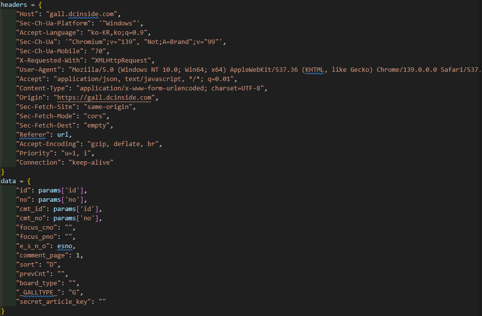

위 사진과 같이 헤더를 설정하고 데이터에 많은 것들을 설정해 주어야 한다. 

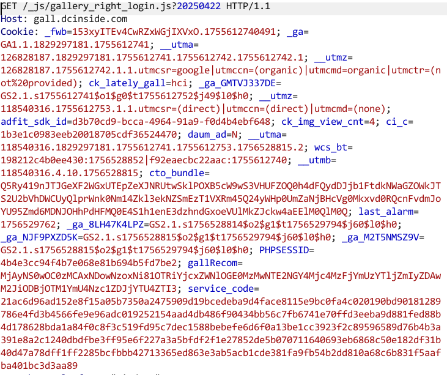

사실 burpsuite로 찍어보았을 때에 위와 같이 되게 많은 쿠키 값이 있어 이 것들이 문제가 될까 싶었는데 저걸 다 지워버려도 요청이 잘 가서 좀 당황했었다.

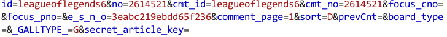

대신 이번에 문제는 위와 같이 보내지는 데이터 중에 `e_s_n_o` 값을 어디서 가져올지에 대한 내용이 더 문제였다.

고로 이 값을 가져오기 위해서는 좀 여기저기 찾아다니며 조사를 해보니

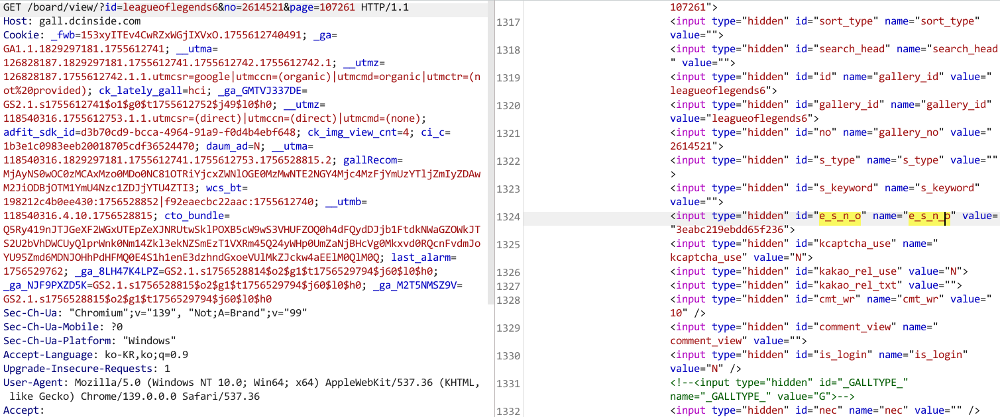

이렇게 처음 게시물을 가져올 때에 `e_s_n_o` 값을 가져온다는 것을 확인할 수 있었다.

[dc_Lots_esno.py](https://github.com/GRAPE-SEC/QuokkaTheLOTS/tree/main/poc/dc-lots/DC_Lots_ver2/dc_Lots_esno.py)

그리하여 만들어진 `e_s_n_o` 추출기 코드는 위와 같다.

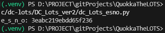

이렇게 코드 자체에 테스트 코드를 넣어놨으니 실행하면 값이 잘 나오는걸 확인해 볼 수 있다. 그리고 지금 코드는 어떤 게시물(url)이 들어오든 값을 추출 할 수 있게 구현해둔 상태이다.

## comment 불러오기

그렇다면 이제 필요한 재료들은 모았고 코맨트 내용을 가져오는 부분을 구현해보자.

[dc_Lots_comment.py](https://github.com/GRAPE-SEC/QuokkaTheLOTS/tree/main/poc/dc-lots/DC_Lots_ver2/dc_Lots_comment.py)

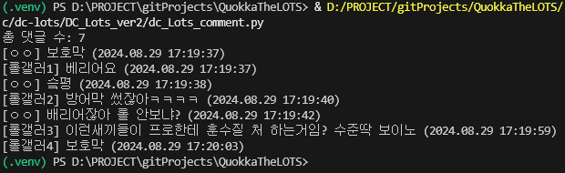

이렇게 드디어 무거운 selenium을 쓰지 않고 댓글 내용을 가져오는데 성공했다.

그럼 이제 다음으론 댓글 내용 삭제와 댓글 입력, 커맨드 실행 등의 코드를 구현할 시간이다.

## 댓글 달기

LOTS를 구현할 때에 우리가 넣은 명령어를 실행하고 나서 결과 값을 댓글로 달아줘야한다. 직접 burpsuite로 요청 내용을 읽어보고 필요없는 부분을 없애보자.

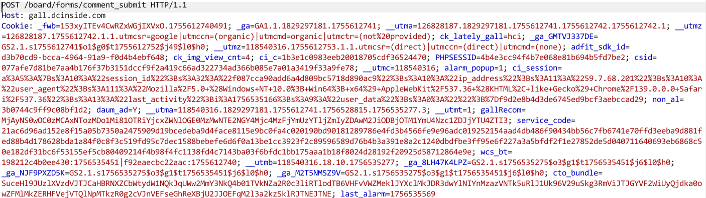

일단은 댓글 불러올 때와 같이 필요 없는 cookie 값을 전부 없애자

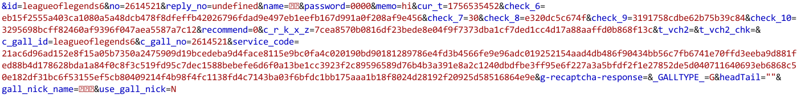

그리고 데이터 필드를 줄일 수 있는 대 까지 줄여보면

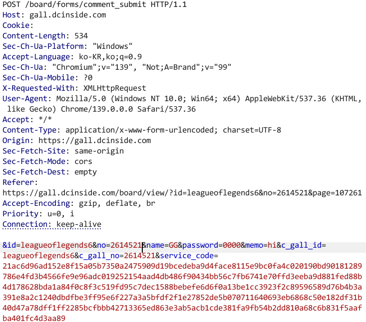

이렇게 많은 쿠키값을 없애고 데이터 필드에 많은 것들을 없애며 확인해본 결과 딱 위와 같이 `id, no, name, password,memo, c_gall_id, c_gall_no, service_code`가 있다.

여기서 하나씩 따져보면

- `id` : 갤러리 (url에 존재)
- `no` : 게시물 넘버 (url에 존재)
- `name` : 게시자 이름 (Lots를 구현할 때에 ver1과 같이 ㅇㅇ으로 할 예정)
- `password` : 댓글 비밀번호 설정 (ver1과 같이 0000)
- `memo` : 댓글에 들어갈 내용
- `c_gall_id` : 갤러리 `id`와 같음
- `c_gall_no` : 게시물 넘버 `no`와 같음
- `service_code` : 게시물 불러올 때 `e_s_n_o`와 같이 `<input type='hidden' name="service_code" value="">`에 있다.

그리고 코드를 구현하여 작업하다보니 계속 디시인사이드 측에서 ip가 막히기에 뭔가 잘못하고 있는 것이 있나 찾아보니 제거하면 안되는 쿠키들이 있었던 것으로 확인되었다.

- `PHPSESSID` : PHP 세션 ID
- `ci_c` : 사이트의 프레임워크인 (Codelgniter)가 사용하는 인증 토큰
- `ci_session` : IP주소 등을 포함한 세션 데이터
- `service_code` : 암호화된 서비스 인증 코드 인데 이건 데이터를 찾았다.

그럼 이제 위 쿠키들은 어디서 찾을 수 있을까?

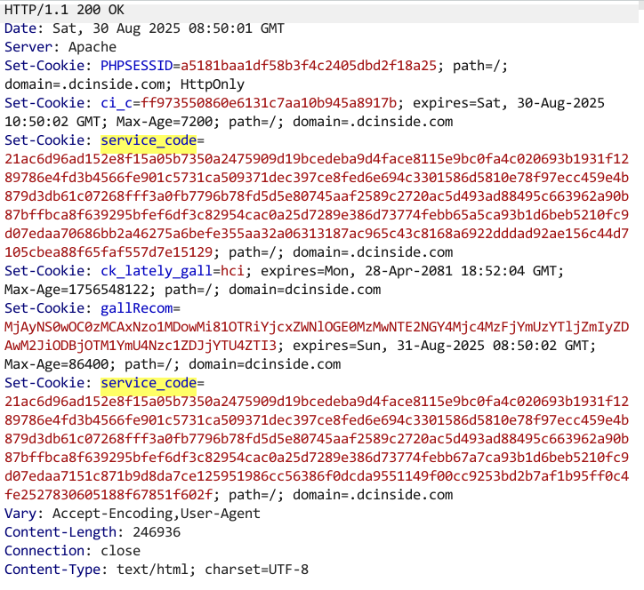

처음 페이지를 불러올 때에 대부분의 값이 나온다.

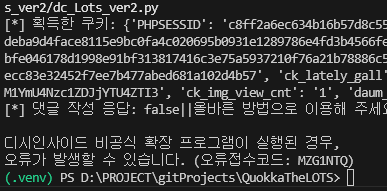

그리고 지금 이 오류로 인해 댓글 다는 과정이 안되어서 일단 1차 종료... 2025-08-30